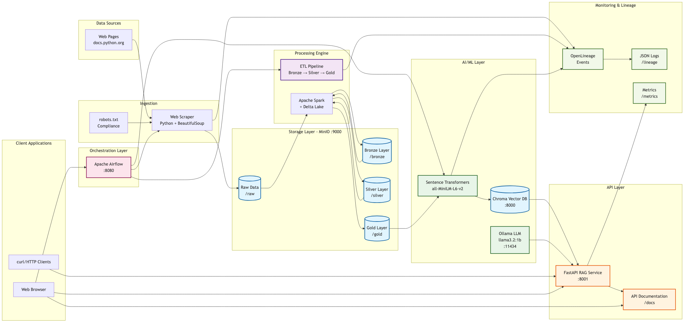

# Data-Scrape-to-RAG Lakehouse

A mini end-to-end "Data-Scrape-to-RAG" lakehouse that scrapes public websites, processes data through Bronze→Silver→Gold layers, generates embeddings, and exposes a RAG API.

## 🏗️ Architecture



## 🚀 Quick Start

```bash
# 1. Setup environment
make setup

# 2. Start all services
make up

# 3. Run full pipeline
make up

# 4. Test RAG API
curl "http://localhost:8001/ask?question=What is Python?"
```

## 📋 Prerequisites

- Docker & Docker Compose
- Make
- 4GB+ RAM available for containers
- Internet connection for scraping

## 🛠️ Development

### Available Commands

```bash
make help          # Show all available commands
make setup         # Initialize environment
make build         # Build Docker images
make up            # Start all services
make down          # Stop services
make clean         # Clean up data and volumes
make test          # Run test suite
make demo          # Quick demo workflow
```

### Service Endpoints

- **Airflow UI**: <http://localhost:8080> (admin/admin)
- **MinIO Console**: <http://localhost:9001> (minioadmin/minioadmin123)
- **RAG API**: <http://localhost:8001/docs>
- **Chroma DB**: <http://localhost:8000>

## 📊 Pipeline Overview

1. **Scrape**: Web scraper fetches pages from docs.python.org
2. **Bronze**: Raw HTML and metadata stored in Delta format
3. **Silver**: Cleaned and normalized text data
4. **Gold**: Chunked text ready for embedding
5. **Embed**: Generate vectors using sentence-transformers
6. **RAG**: Query interface with local LLM via Ollama

## 🔧 Configuration

Environment variables are configured in `.env` (copied from `.env.example`):

- `SCRAPE_BASE_URL`: Target website to scrape
- `SCRAPE_MAX_PAGES`: Maximum pages to process
- `OLLAMA_MODEL`: LLM model for RAG responses (default pulled automatically in `ollama-entrypoint.sh`)
- `EMBEDDING_MODEL`: Sentence transformer model

## 📁 Project Structure

```md
├── airflow/dags/           # Airflow DAG definitions
├── src/
│   ├── common/            # Shared utilities
│   ├── scraper/           # Web scraping logic
│   ├── etl/               # Data transformation
│   ├── embeddings/        # Vector generation
│   └── api/               # FastAPI RAG service
├── sample_config/         # Scraping configuration
├── tests/                 # Test suite
├── data/                  # Data storage (mounted volumes)
└── lineage/               # OpenLineage events
```

## 🧪 Testing

```bash
# Run all tests
make test

# Test individual components
docker-compose exec airflow-scheduler python -m pytest tests/test_scraper.py -v
```

## 📈 Monitoring

- **Airflow UI**: Monitor DAG execution and logs
- **MinIO Console**: Browse data lake contents  
- **API Metrics**: `/metrics` endpoint for Prometheus
- **Lineage**: OpenLineage events in `/lineage` directory
- **Prometheus**: <http://localhost:9090> - Metrics collection
- **Grafana**: <http://localhost:3000> (admin/admin) - Dashboard visualization

### Grafana Dashboards

The project includes pre-configured Grafana dashboards:

- **Data Pipeline Overview**: Complete pipeline monitoring including scraping, ETL, embeddings, and API metrics
- **Service Health**: Real-time status of all services

To export/import dashboards:

```bash
# Export all dashboards
python monitoring/dashboard_manager.py export --all

# Import a dashboard
python monitoring/dashboard_manager.py import monitoring/grafana/dashboards/data-pipeline-overview.json
```

## 🎥 Demo Video

> **TODO**: Add link to 5-minute demo video showing:
>
> 1. `docker compose up`
> 2. Trigger Airflow DAG
> 3. Show MinIO buckets and Delta tables
> 4. Call `/ask` endpoint twice

## 🔍 Troubleshooting

### Common Issues

**Services not starting:**

```bash
make down && make clean && make up
```

**Out of memory:**

- Reduce `SCRAPE_MAX_PAGES` in `.env`
- Increase Docker memory limit

**Scraping blocked:**

- Check `robots.txt` compliance
- Adjust `SCRAPE_DELAY_SECONDS`

### Logs

```bash
# View all service logs
make logs

# Specific service logs
docker-compose logs -f airflow-scheduler
docker-compose logs -f rag-api
```

## 🚧 Implemented Nice-to-Have Features

- [x] JavaScript rendering with Playwright (configurable via `SCRAPER_ENGINE`)
- [x] Configurable site URL via environment variable (`SCRAPE_BASE_URL`)
- [x] S3 storage support (switch via `STORAGE_BACKEND`)
- [x] GPU-accelerated embeddings (auto-detected, set `EMBEDDING_DEVICE=cuda`)
- [x] Streaming API responses (`/ask/stream` endpoint)
- [x] pytest-airflow DAG tests
- [x] Marquez integration for lineage visualization (enable via `MARQUEZ_ENABLED`)
- [x] Grafana dashboards for monitoring
- [x] GitHub Actions CI/CD pipeline

## 🔄 CI/CD Pipeline

The project includes GitHub Actions workflows for:

- **CI Pipeline**: Linting, testing, and building on every push
- **Docker Publishing**: Automated image builds and registry push on releases

### Running CI Locally

```bash
# Install development dependencies
pip install ruff black isort mypy pytest pytest-cov

# Run linting
ruff check src/ tests/
black --check src/ tests/
isort --check-only src/ tests/

# Run tests
pytest tests/ -v --cov=src
```

## 🚀 Future Enhancements

- [ ] Kubernetes Helm charts for production deployment
- [ ] Advanced RAG with reranking and hybrid search
- [ ] Real-time streaming data ingestion
- [ ] Multi-language support for scraping
- [ ] Distributed Spark processing on Kubernetes
- [ ] MLflow integration for model versioning

## 📄 License

MIT License - see LICENSE file for details.

## 🤝 Contributing

1. Fork the repository
2. Create feature branch
3. Add tests for new functionality
4. Submit pull request

## LLM Integration (LiteLLM)

This project uses [LiteLLM](https://github.com/BerriAI/litellm) as a unified client for both embeddings and text generation (completions). On container start the entrypoint script pulls the required models, so the API is ready on first request. You can switch to OpenAI or any other provider by adjusting environment variables.

### Example configuration for Ollama (local)

```text
LITELLM_API_BASE=http://localhost:11434
LITELLM_MODEL=qwen3:0.6b
LITELLM_EMBED_MODEL=mahonzhan/all-MiniLM-L6-v2
# LITELLM_API_KEY=  # Only needed for remote providers
```

- The embedding pipeline and RAG API both use LiteLLM for all LLM operations.
- To switch providers, just change the environment variables.

See `sample_config/site.yaml` for a sample config.

---

**Built with**: Python, Apache Airflow, DuckDB, Delta Lake, MinIO, Chroma, FastAPI, Ollama, Prometheus, Grafana
